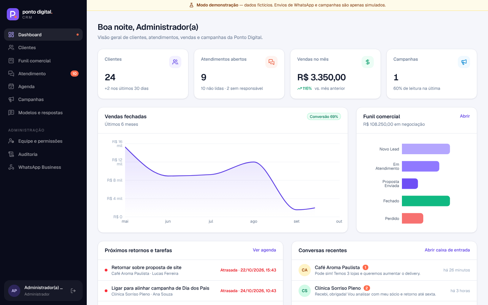

# Ponto Digital CRM

CRM da agência **Ponto Digital**: clientes, funil comercial, atendimento pelo WhatsApp (API oficial da Meta), campanhas com consentimento, agenda, equipe com permissões e auditoria. Funciona no computador e no celular e pode ser instalado como aplicativo (PWA).

> **Versão atual: 1ª versão funcional em modo demonstração.** Os dados são fictícios e ficam em `.data/demo-db.json` no seu computador. **Nenhuma mensagem de WhatsApp é enviada** — envios e campanhas são simulados. O banco Supabase e a integração oficial do WhatsApp entram nas próximas etapas, somente com a sua autorização.



## Funcionalidades

| Módulo | O que faz |
| --- | --- |
| **Dashboard** | Clientes, atendimentos abertos, vendas do mês (com variação), campanhas, gráfico de vendas (6 meses), funil, próximas tarefas e conversas recentes. |
| **Clientes** | Cadastro com nome, telefone (padronizado no formato do WhatsApp), cidade, serviços contratados, etiquetas, responsável e observações. Busca e filtros. |
| **Importação CSV** | Aceita `,` ou `;`, reconhece colunas em português, padroniza telefones e **elimina duplicidades** (no arquivo e na base, inclusive números com/sem o nono dígito). Prévia antes de importar. |
| **Funil comercial** | Novo Lead → Em Atendimento → Proposta Enviada → Fechado / Perdido. Arrastar e soltar no computador; seletor de etapa no celular. |
| **Atendimento** | Caixa de entrada por cliente, histórico completo, responsável, transferência, status (aberta/pendente/resolvida), indicação da origem (CRM, **app WhatsApp Business**, histórico sincronizado, campanha) e da **janela de 24h** da Meta. |
| **Respostas rápidas e modelos** | Atalhos com `/` na conversa. Modelos (templates) com categoria, variáveis `{{1}}` e status de aprovação. |
| **Campanhas** | Segmentação por cidade, serviço, etapa e etiqueta; **apenas contatos com consentimento**; descadastrados sempre excluídos; somente modelos aprovados; acompanhamento de entregas, leituras, respostas e descadastros. |
| **Descadastro** | Mensagens "SAIR", "PARAR", "STOP" descadastram automaticamente e ficam registradas. |
| **Agenda** | Retornos, ligações, reuniões e propostas por responsável — atrasadas, hoje, próximos dias. |
| **Equipe e permissões** | Perfis Administrador, Gestor e Atendente, com matriz de permissões verificada no servidor. Desativar um usuário encerra as sessões dele na hora. |
| **Login seguro** | Senhas com hash `scrypt`, sessão assinada (HMAC), limite de tentativas, recuperação de senha por link de uso único (30 min). |
| **LGPD** | Registro e histórico de consentimento, exportação dos dados do titular (JSON), anonimização, auditoria de todas as ações. |

## Requisitos

- **Node.js 20.9 ou superior** (recomendado: versão LTS 22) — https://nodejs.org
- **Git** (para baixar e atualizar o projeto)
- Navegador atualizado (Chrome, Edge, Safari ou Firefox)

Opcional, para as próximas etapas: conta no **Supabase** (banco e autenticação) e conta de desenvolvedor da **Meta** (WhatsApp Cloud API).

## Como executar no seu computador

```bash
# 1. Entre na pasta do projeto
cd Ponto-Digital-CRM

# 2. Instale as dependências (só na primeira vez)
npm install

# 3. Gere o arquivo de configuração com senhas e segredos aleatórios
npm run setup
#    → o comando mostra o e-mail e a senha de acesso. Guarde em local seguro.

# 4. Inicie o sistema
npm run dev
```

Abra **http://localhost:3000** e entre com `admin@pontodigital.demo` e a senha exibida no passo 3.
Usuários da equipe de demonstração: `lucas@` (gestor), `ana@` e `pedro@` (atendentes) `@pontodigital.demo`, com a senha "Equipe" exibida no passo 3. As senhas ficam no arquivo `.env.local` (que nunca vai para o Git).

Para usar a versão otimizada (mais rápida): `npm run build` e depois `npm start`.

### Recuperação de senha no modo demonstração

Como ainda não há envio de e-mail, o link de redefinição aparece no terminal onde o sistema está rodando e no arquivo `.data/outbox.log`. Com o Supabase, o e-mail passa a ser enviado de verdade.

### Recomeçar com os dados demonstrativos

```bash
npm run demo:reset   # depois reinicie o `npm run dev`
```

### Instalar como aplicativo (PWA)

Com o sistema publicado em HTTPS: no celular, abra o endereço e use **"Adicionar à tela inicial"** (Safari/iPhone) ou **"Instalar aplicativo"** (Chrome/Android). No computador, clique no ícone de instalação na barra de endereços. Por segurança (LGPD), os dados dos clientes **não** ficam guardados no aparelho — só a interface.

## Testes

```bash
npm test            # testes unitários (telefones, CSV, segmentação, webhooks, assinatura, permissões)
npm run typecheck   # verificação de tipos
npm run lint        # padrões de código
```

Teste ponta a ponta (34 cenários: login, cadastro, importação, funil, atendimento, descadastro, campanha, agenda, permissões, recuperação de senha, LGPD, auditoria e webhook) — exige o Playwright instalado e o sistema rodando com dados recém-criados:

```bash
npm run demo:reset && npm run dev   # em um terminal
node scripts/e2e.cjs "<senha admin>" "<senha equipe>" "$PWD"   # em outro
```

Teste do banco (isolamento por organização / RLS), num PostgreSQL local:

```bash
createdb pdcrm_test && psql -d pdcrm_test -f supabase/tests/rls-test.sql
```

## Estrutura

```
Ponto-Digital-CRM/
├── src/
│   ├── app/
│   │   ├── (auth)/               login, esqueci-senha, redefinir-senha
│   │   ├── (app)/                área logada: dashboard, clientes, funil, inbox,
│   │   │                         agenda, campanhas, modelos, equipe, auditoria,
│   │   │                         configuracoes/whatsapp  (+ actions.ts de cada módulo)
│   │   ├── api/webhooks/whatsapp webhook oficial da Meta (verificação + eventos)
│   │   ├── api/clientes/[id]/exportar   exportação LGPD
│   │   └── manifest.ts, offline/ PWA
│   ├── components/               interface (ui, layout, gráficos)
│   ├── lib/
│   │   ├── auth/                 sessão assinada, senhas (scrypt)
│   │   ├── data/                 tipos, repositório por organização, base demo
│   │   ├── whatsapp/             cliente Cloud API, parser de webhooks, assinatura
│   │   ├── csv.ts, phone.ts, segmentation.ts, permissions.ts, env.ts
│   └── proxy.ts                  proteção das rotas
├── supabase/migrations/          esquema PostgreSQL com Row Level Security
├── supabase/tests/               testes de isolamento do banco
├── docs/                         WhatsApp/coexistência, segurança/LGPD, capturas
├── public/                       ícones, service worker
├── scripts/                      setup e teste ponta a ponta
└── .env.example                  todas as variáveis (sem valores secretos)
```

## Segurança (resumo)

- Nenhum token ou senha no código: tudo em variáveis de ambiente (`.env.local`, fora do Git).
- Autorização verificada **no servidor** em cada página e ação; isolamento por organização em todas as consultas (e por RLS no Supabase).
- Webhooks do WhatsApp aceitos somente com assinatura `X-Hub-Signature-256` válida; processamento idempotente.
- Cabeçalhos de segurança (CSP, HSTS, X-Frame-Options, Referrer-Policy) e cookies `HttpOnly`/`SameSite`/`Secure`.
- Travas de envio: `WHATSAPP_SEND_MODE=simulacao` e `WHATSAPP_CAMPAIGNS_LIVE=false` por padrão; campanhas reais recusadas nesta versão; testes automatizados nunca enviam.

Detalhes em [docs/SEGURANCA_LGPD.md](docs/SEGURANCA_LGPD.md) e [docs/WHATSAPP_COEXISTENCIA.md](docs/WHATSAPP_COEXISTENCIA.md).

## Próximas etapas

1. **Sua aprovação desta primeira versão.**
2. **Supabase**: criar o projeto (plano gratuito disponível), aplicar `supabase/migrations`, trocar `DATA_BACKEND` para `supabase` e ligar o Supabase Auth (e-mails de recuperação). Preciso que você crie o projeto e me passe a URL e as chaves pelo `.env.local` — nunca por mensagem.
3. **Hospedagem** (ex.: Vercel) com domínio HTTPS — só com sua autorização, pois publica o sistema.
4. **WhatsApp oficial com coexistência** — ver o plano em `docs/WHATSAPP_COEXISTENCIA.md`. Nenhuma alteração no seu número sem a sua aprovação.
